<h3><code>whoami</code></h3>

<table>
  <tr>
    <td valign="top"></td>
    <td valign="top"></td>
  </tr>
</table>

 

<h3><code>open source</code></h3>

I'm currently putting most of my open source effort into [OpenMRS](https://openmrs.org), working on the stock management and billing backends: Hibernate queries, Liquibase changesets, REST resources, and the tests that pin down each fix. I also review other contributors' pull requests.

**Merged**

| Project | Pull request | What it does |
|---|---|---|
| OpenMRS stock management app | [#701](https://github.com/openmrs/openmrs-esm-stock-management-app/pull/701) | Shows Stock Management in the App Menu (O3-6226) |
| OpenMRS stock management app | [#708](https://github.com/openmrs/openmrs-esm-stock-management-app/pull/708) | Keeps stock source changes out of the list until saved (O3-6213) |
| OpenMRS stock management app | [#709](https://github.com/openmrs/openmrs-esm-stock-management-app/pull/709) | Loads stock source types into the Operations filter (O3-6223) |
| OpenMRS stock management app | [#711](https://github.com/openmrs/openmrs-esm-stock-management-app/pull/711) | Keeps saved item details when returning to the Details tab (O3-6214) |
| Kornia | [#6583](https://github.com/kornia/kornia/pull/6583) | Deprecates the unused `validate_boxes` and `is_batch` arguments (#6552) |
| pyNeuroML | [#481](https://github.com/NeuroML/pyNeuroML/pull/481) | Fixes the `max_memory` docstring type in `runners.py` (#462) |

**In review**

| Project | Pull request | What it does |
|---|---|---|
| OpenMRS stock management module | [#61](https://github.com/openmrs/openmrs-module-stockmanagement/pull/61) | Fixes the HQL behind stock rules that exclude child locations (O3-6283) |
| OpenMRS stock management module | [#60](https://github.com/openmrs/openmrs-module-stockmanagement/pull/60) | Matches new batches on expiry date, not only batch number (O3-6261) |
| OpenMRS stock management module | [#57](https://github.com/openmrs/openmrs-module-stockmanagement/pull/57) | Computes operation permissions per request instead of caching them (O3-6248) |
| OpenMRS stock management module | [#56](https://github.com/openmrs/openmrs-module-stockmanagement/pull/56) | Rejects stock sources with duplicate names or acronyms (O3-6176) |
| OpenMRS billing module | [#198](https://github.com/openmrs/openmrs-module-billing/pull/198) | Reopens a paid bill when the payment that settled it is voided (O3-6293) |
| OpenMRS reporting module | [#278](https://github.com/openmrs/openmrs-module-reporting/pull/278) | Adds a `drugOrderSearch` built-in cohort definition (O3-6179) |
| OpenMRS content packages | [demo #91](https://github.com/openmrs/openmrs-content-referenceapplication-demo/pull/91), [showcase #3](https://github.com/openmrs/openmrs-content-referenceapplication-showcase/pull/3) | Moves stock locations and tags out of the module into content (O3-4520) |
| OpenELIS Global | [#5070](https://github.com/DIGI-UW/OpenELIS-Global-2/pull/5070), [#5074](https://github.com/DIGI-UW/OpenELIS-Global-2/pull/5074) | Adds role checks to REST controllers that any logged-in user could reach (#3966) |

**Reviews:** [stock management #55](https://github.com/openmrs/openmrs-module-stockmanagement/pull/55), [openmrs-core #6790](https://github.com/openmrs/openmrs-core/pull/6790), [openmrs-core #6792](https://github.com/openmrs/openmrs-core/pull/6792)

<h3><code>contributions</code></h3>

  

Backend &amp; Applied AI Engineer &middot; GDG On Campus Lead @ APSIT &middot; Google Student Ambassador '26 (Gemini)

[Portfolio](https://avanish.tech) &nbsp;&middot;&nbsp; [LinkedIn](https://www.linkedin.com/in/avanishkasar) &nbsp;&middot;&nbsp; [Linktree](https://linktr.ee/Avanish_Kasar) &nbsp;&middot;&nbsp; [Email](mailto:avanishkasar57@gmail.com)

<!--
Regenerate locally:
  python scripts/make_ascii_svg.py        # avi-ascii.svg   (static wordmark, run only when text changes)
  python scripts/make_info_card.py        # info-card.svg   (static, run only when details change)
  python scripts/fetch_contributions.py   # data/contributions.json (real data, no token)
  python scripts/render_heatmap_svg.py    # contrib-heatmap.svg (GitHub's own levels + Primer palette, light/dark)
  Both run daily via .github/workflows/update-profile-art.yml -- keep that workflow enabled in the Actions tab.
-->
